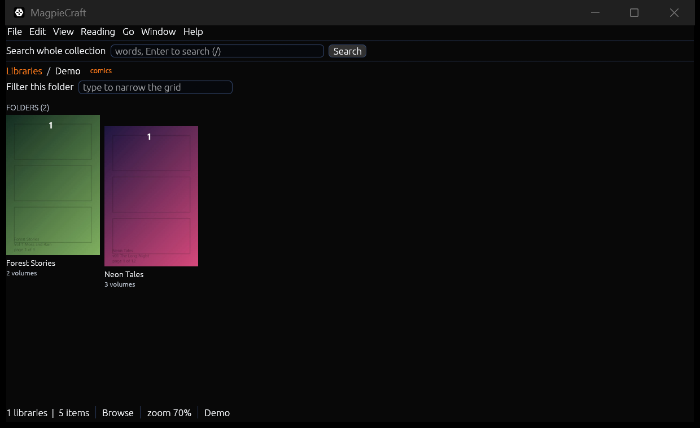
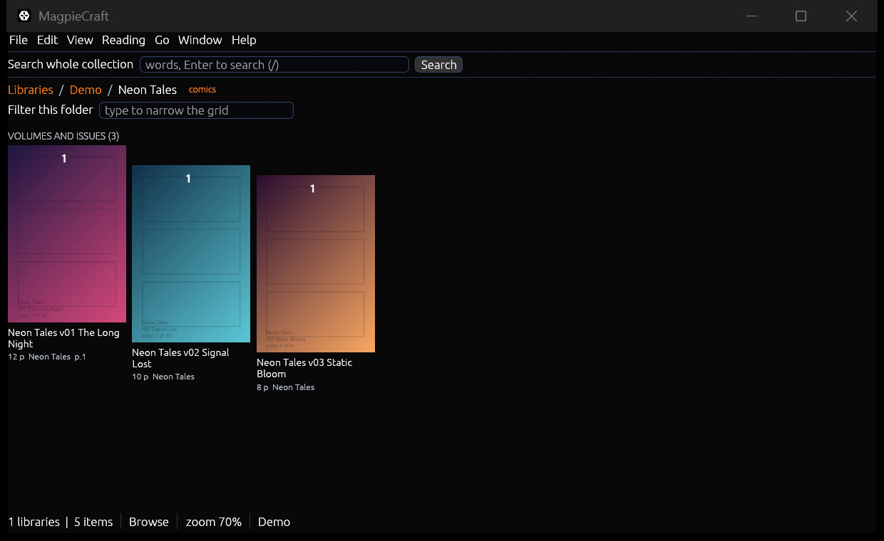
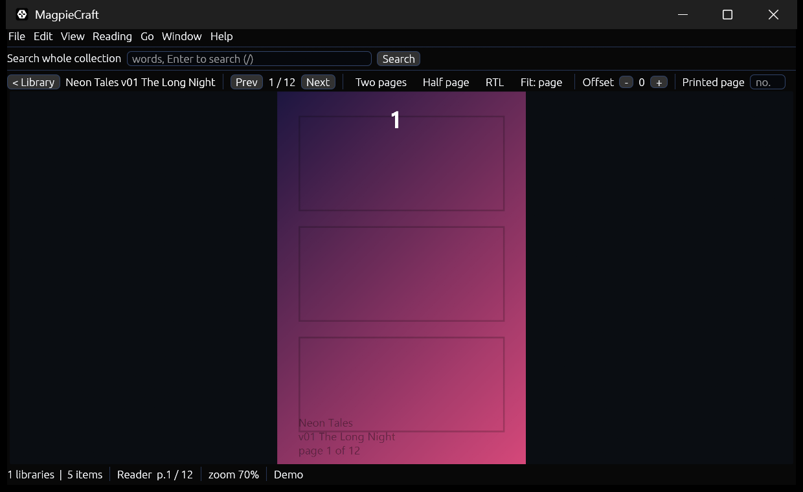
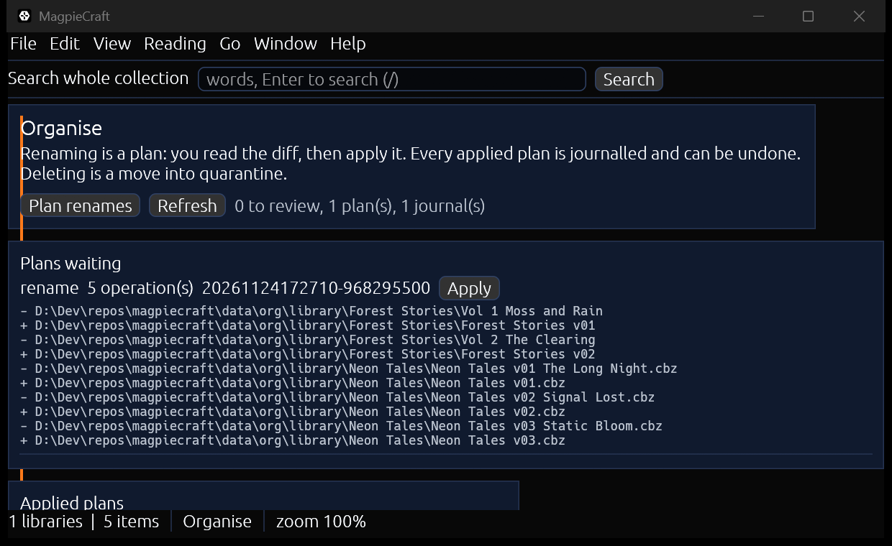
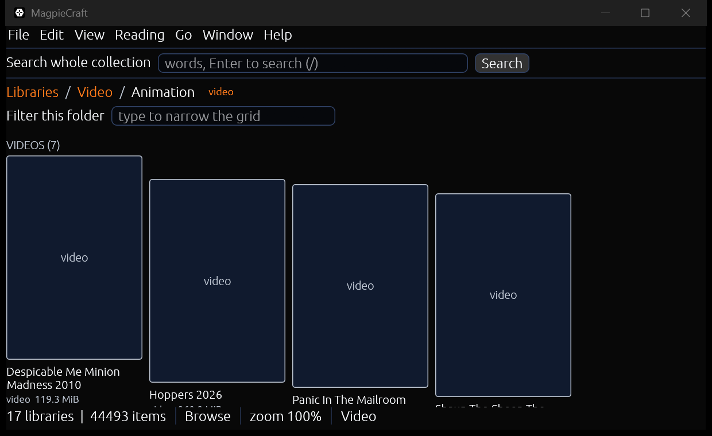
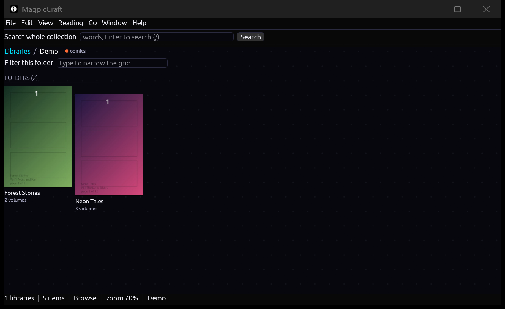
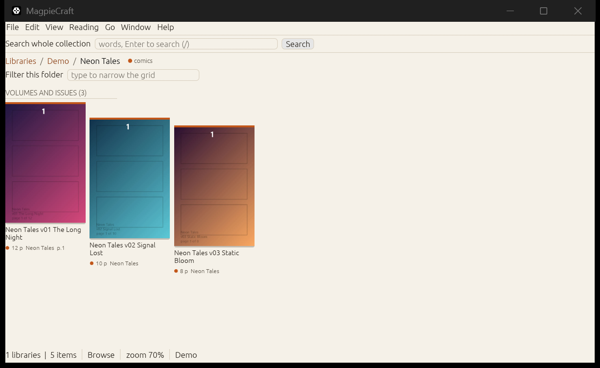
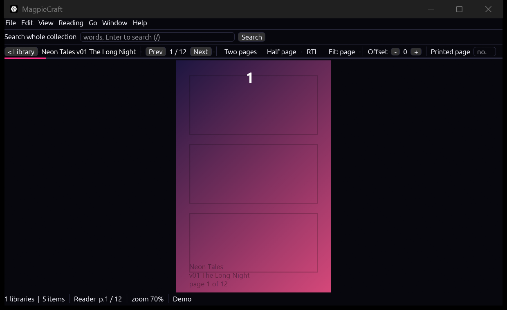
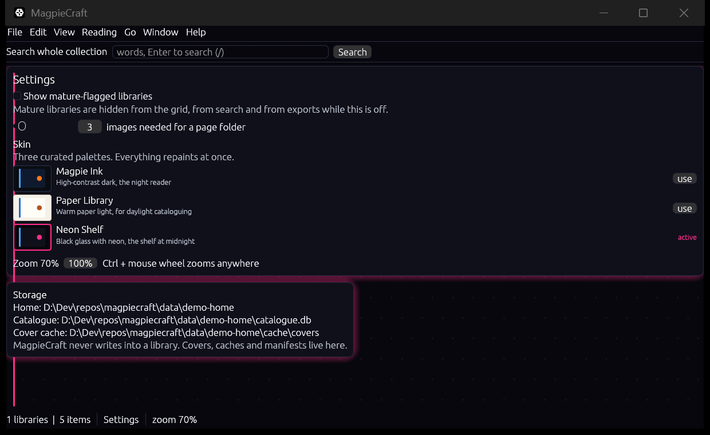

# MagpieCraft

**Inventory and read the comics, manga and media collection you already own.**
One pure-Rust desktop app, one CLI and one MCP server. No downloads, no DRM circumvention, no accounts,
no telemetry, no open ports.

MagpieCraft is part of the Storytold craft family and follows the fleet's Pure-Rust ArtCraft
standard: an L1 engine crate, an L2 CLI + MCP binary and an L3 egui desktop app, all calling the same
command bus in process.

> **This project is not for piracy.** It contains no and will accept no features, advice or examples
> for obtaining copyrighted works from unauthorised sources (piracy sites, torrent or Usenet
> indexers, trackers, shadow libraries, scene sources), automating such downloads, breaking DRM, or
> scraping metadata from grey sources. Metadata comes from embedded data, your own files, openly
> licensed dumps and official APIs under their terms. Issues and pull requests that add any of the
> above are rejected.

## Preview

| Library grid | Folders with covers | Reader |
|---|---|---|
|  |  |  |

| Organise: plans, diffs and undo |
|---|
|  |

| A video library: same catalogue, different kind |
|---|
|  |

| Skins: Neon Shelf grid, Paper Library volumes, Neon reader |
|---|
|  |
|  |
|  |

| Organise with the skin picker open |
|---|
|  |

Screenshots come from the synthetic demo library (`scripts/make-demo-library.ps1`), never from a real
collection, so no copyrighted page is published. How to reproduce them: `docs/DEVELOPMENT.md`.

## What it does today

- Indexes **every media kind you own**, not just comics: films and series, music, books, comics,
  manga, magazines and photos. The library kind decides how a file is read (a `.jpg` is a page in a
  comics library and a photo in a photo library); the file itself decides what it is (a `.mkv` in a
  comics library is still a video).
- Scans incrementally by path, size and mtime. A second scan of 100,000 files takes under a second and
  opens nothing it already knows.
- Reads ComicInfo.xml, groups volumes into series, and defaults reading direction per library, series
  or item.
- Reads comics in a native reader: fit page or fit width, two-page spreads with the cover alone,
  half-page mode with a 12 percent overlap, right to left, printed-page offset, progress, prefetch,
  keyboard.
- Searches the whole collection with FTS5, falling back to substring matching when a word is inside
  another word.
- Verifies integrity: BLAKE3 on demand, exact duplicates by size then hash, and checksum manifests that
  detect bitrot later.
- Shows what the collection is: items, pages, bytes, series, and totals per media kind and per drive,
  including drives that are currently unplugged.
- **Proposes renames you can read before they happen**, kind-aware: films by title and year, episodes by
  series and SxxExx, comics by series and volume. Books and music are left to Calibre, BookCraft and
  your tagger, and say so. Every applied plan is journalled and reversible.
- **Opens what it cannot show in itself.** A click on a film or a track launches your player with the
  file and the position it left off at (VLC or mpv, overridable), and "continue" then lists it next to
  your comics with the time watched. Books and photos go to the OS handler. MagpieCraft never decodes
  media itself; playback is a hand-off, not a built-in engine (decision D8).

The behavioural oracle for the grid and the reader is the browser prototype Sandra uses
(`heavymetal-site/magpie_proto.py`). `docs/READER_PARITY.md` lists every scenario and whether the Rust
app matches it.

## Feature matrix

Status is `Implemented`, `Partial` or `Planned`. Nothing is implied by omission.

### A. Inventory and catalogue

| Feature | Status | Notes |
|---|---|---|
| Library roots, multiple kinds, mature flag | Implemented | Mature libraries are hidden from the grid, from search and from the CLI until enabled |
| Every media kind indexed: video, audio, ebook, comic, manga, magazine, photo | Implemented | Kind comes from the file's format and the library's kind; subtitles, `.opf` and other sidecars are not items |
| Kind totals in statistics | Implemented | Items, bytes and pages per kind |
| Incremental scan by path, size and mtime | Implemented | Unchanged archives are not reopened |
| CBZ / ZIP page listing and page count | Implemented | Natural order, `__MACOSX` and dotfiles skipped |
| Numbered image folders as volumes | Implemented | Leaf-most folder with at least N images (default 3, configurable) |
| CBR / RAR / CB7 / 7Z | Implemented | Page list from the 7-Zip index (no extraction); pages extracted once into the app cache with a lock and a size cap |
| PDF | Implemented | Page count from `pdfcraft-cli info`, pages rendered by PdfCraft at 200 dpi into the cache |
| AVIF | Partial | Indexed; the decoder decision (native library cost) is still open |
| ComicInfo.xml | Implemented | Series, number, year, page count, credits, right-to-left flag |
| Series grouping from folders and file names | Implemented | Parsing with confidence; uncertain names go to the review queue |
| Review queue | Implemented | `review`, and `media_curate review`; clears when the name or ComicInfo is fixed |
| BLAKE3 on demand | Implemented | `hash`, or `media_health hash` |
| Exact duplicates | Implemented | Size first, then hash |
| Checksum manifests and verification | Implemented | Tab separated, written outside the library |
| Verification schedule | Implemented | `verify` says what is due (default 30 days); `verify-run` writes the baseline, compares afterwards, and records every run |
| Cleanup: empty folders, orphan sidecars, samples, junk | Implemented | A plan of quarantines with reasons; an ebook library is never touched automatically |
| Backup status (3-2-1 view) | Implemented | Compares each library with the copies under the configured backup roots; a count, not a checksum |
| Verified backup copy | Implemented | `backup-plan --to <root>` copies what is missing, checksums every copy against its source, never overwrites, and undo removes only the copies |
| ffmpeg presets, planned and applied like everything else | Implemented | `presets` lists the four recipes; `plan-convert --preset` plans one video or track, apply encodes with ffmpeg, undo deletes the output |
| Subtitles: list sidecars and embedded tracks | Implemented | `subs <key>` shows sidecars with their cue count and the embedded streams ffprobe reports |
| Subtitles: shift and convert (SRT/VTT) | Implemented | Pure text: `subs-shift --by <seconds>`, `subs-convert --to srt\|vtt`. New file only, never overwrites, ASS is read-only |
| Subtitles: extract an embedded track | Implemented | `subs-extract --stream N --out file` through ffmpeg |
| Subtitles: local generation | Planned | Whisper-class on the GPU; the fleet rule is a Rust engine (whisper-rs or speechcraft), never Python |
| Near-duplicate detection | Implemented | Images by perceptual hash (dHash, 10 of 64 bits); videos by title, year, episode marker and Part/CD suffix. The report says which is which |
| Verified backup copy | Implemented | `backup-plan --to <root>` copies what is missing, checksums every copy against its source, never overwrites, and undo removes only the copies |
| ffmpeg presets: remux, MP4 compat, loudness, strip metadata | Implemented | Planned per item with `plan-convert`, encoded on apply, output verified, undo deletes it |
| Drive health (SMART) | Planned | Needs a Windows API pass |
| FTS5 search | Implemented | Prefix tokens, diacritics folded, substring fallback |
| Offline drive catalogue | Partial | Per-volume item counts and online state; free space and growth need a Tier 3 pass |
| Technical inspection (ffprobe) | Implemented | Video and audio files; ffprobe is optional |
| Broken-file detection | Partial | A corrupt archive reports an unreadable page list; decode checks are Tier 3 |
| Statistics and reports | Partial | Sizes, pages, kinds, drives; decades, languages and gaps are Tier 3+ |
| Physical items (shelf catalogue) | Planned | Tier 5 |

### B. Identify, tag and organise

| Feature | Status | Notes |
|---|---|---|
| Rename plan with diff | Implemented | Pure naming rules, golden tested; collisions are reported and refused, never overwritten |
| Kind-aware presets: comics, manga, films, TV episodes | Implemented | `auto` picks by item kind; a rename never moves an item out of its folder |
| Books and music naming | Planned | Left to Calibre, BookCraft and your tagger on purpose; the plan says so instead of guessing |
| Apply on confirm | Implemented | `apply --confirm`; refuses without it |
| Undo journal | Implemented | Every applied plan is journalled; `undo --confirm` restores paths and reading progress; a journal undoes once |
| Quarantine instead of delete | Implemented | Moves into `quarantine/<timestamp>/<library>/`; undo returns the file |
| Reading progress follows a rename | Implemented | The progress key is rewritten with the item path |
| Identify from metadata | Planned | Local dumps first (GCD, MangaBaka), then APIs with per-provider limits |
| NFO and artwork in Jellyfin/Kodi layout | Planned | Tier 2 remainder |
| Tag writing | Planned | Tier 2 remainder |

### C to F (later tiers)

| Pillar | Status |
|---|---|
| C. Near duplicates, backup planner, SMART | Planned (Tier 3) |
| D. Convert, subtitle generation, CD ripping, print scanning | Partial: subtitle sidecars listed, shifted and converted; the rest planned |
| E. Knowledge graph and federated sources | Planned (Tier 4; the source registry exists) |
| F. Gaps, wishlist and the curated source guide | Planned (Tier 5) |

### Reader and interfaces

| Feature | Status |
|---|---|
| egui library grid with covers, breadcrumbs, folder filter | Implemented |
| Continue-reading row | Implemented |
| Whole-collection search box | Implemented |
| Reader: single page, spread with cover alone, half page, RTL, page jump, offset | Implemented |
| Reader: CBR/RAR and PDF pages (7-Zip and PdfCraft) | Implemented |
| Reader: prefetch and decode off the UI thread | Implemented |
| Open with player: resume position, player discovery, continue row for films | Implemented |
| Built-in decoder, subtitle rendering, transcoding, streaming server | Not built, by decision D8 |
| Ctrl + wheel zoom; three curated skins (Magpie Ink, Paper Library, Neon Shelf) | Implemented |
| Per-kind accent colours, card shadows, procedural backdrops | Implemented |
| CLI with `--json` | Implemented |
| MCP stdio server: `media_catalog`, `media_search`, `media_read`, `media_health` | Implemented |
| OPDS server, static site export | Planned (Tier 2/3) |
| Installer, .mcpb bundle, release assets | Planned (release tier) |

## Install

Requires Rust 1.82 or newer. No Python, no Node, no runtime services.

```powershell
git clone https://github.com/sandraschi/magpiecraft
cd magpiecraft
cargo build --release --workspace
```

Two binaries:

- `target\release\magpiecraft.exe` - the desktop app
- `target\release\magpiecraft-mcp.exe` - the CLI and the MCP stdio server

CLI first:

```powershell
magpiecraft-mcp library-add Comics "L:\Multimedia Files\Comics" --kind comics
magpiecraft-mcp scan
magpiecraft-mcp browse
magpiecraft-mcp search saga --limit 10
magpiecraft-mcp status --json
```

MCP client configuration (Claude Desktop or any stdio client):

```json
{
  "mcpServers": {
    "magpiecraft": {
      "command": "D:/Dev/repos/magpiecraft/target/release/magpiecraft-mcp.exe",
      "args": ["mcp"]
    }
  }
}
```

Optional external tools, detected at runtime and never linked: `ffprobe` (technical inspection),
7-Zip (CBR/RAR, Tier 2), `pdfcraft-cli` (PDF pages, Tier 2). Absence is reported in `status` and in
Health, never hidden.

Full instructions, including the data directory and environment variables: [INSTALL.md](INSTALL.md).

## Where your data lives

`%LOCALAPPDATA%\magpiecraft` (or `$XDG_DATA_HOME/magpiecraft`, or `MAGPIECRAFT_HOME`):

| Path | What |
|---|---|
| `catalogue.db` | Libraries, items, series, progress, FTS index |
| `settings.json` | Skin, zoom, mature visibility, page-folder threshold |
| `cache/covers` | Cover thumbnails, rendered from your files |
| `manifests` | Checksum manifests |

Nothing is ever written into a library. Covers, caches and manifests live here.

## Documentation

| File | Contents |
|---|---|
| [INSTALL.md](INSTALL.md) | Build, register, first library, external tools |
| [docs/TOOLS.md](docs/TOOLS.md) | Every CLI command and MCP tool with examples |
| [docs/ARCHITECTURE.md](docs/ARCHITECTURE.md) | Crates, command bus, schema, scanning contract |
| [docs/READER_PARITY.md](docs/READER_PARITY.md) | Prototype scenarios and the reader's behaviour |
| [docs/BENCHMARKS.md](docs/BENCHMARKS.md) | The 100,000-file scan measurement |
| [docs/ATTRIBUTION.md](docs/ATTRIBUTION.md) | Provider terms, external tools, licences |
| [docs/DEVELOPMENT.md](docs/DEVELOPMENT.md) | Tests, fixtures, environment, style |
| [HELP.md](HELP.md) | User help: keys, what works, what does not |
| [HANDOVER.md](HANDOVER.md) | What the next agent must know |

## Quality gates

Measured 2026-11-24 on the Tier 2 commit:

- `cargo test --workspace`: **180 passed**, 0 failed
- `cargo clippy --workspace --all-targets --all-features -- -D warnings`: clean
  (`unwrap_used`, `expect_used`, `panic`, `todo`, `unimplemented` denied workspace-wide)
- `cargo fmt --all --check`: clean
- MCP stdio probe: `initialize` -> `tools/list` -> `tools/call` verified, stdout pure JSON-RPC
- Synthetic scan: 100,000 files in 478 ms (see `docs/BENCHMARKS.md`)
- Organise round trip: plan, apply, undo verified on a real folder tree, including reading progress

There is no `todo!()` or `unimplemented!()` reachable from any entry point. Unbuilt paths return
`not_implemented` with a reason.

## Licence and credits

MIT OR Apache-2.0. No copyrighted media is in this repository: every test fixture is generated in the
test. Third-party tools are invoked as subprocesses and never linked (see `docs/ATTRIBUTION.md`).
